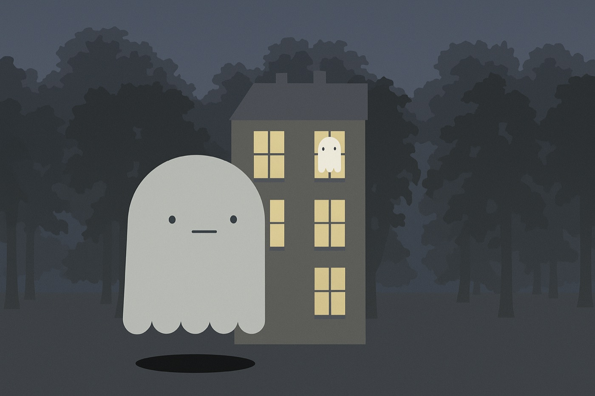

# Ghost Game 👻

A small, fully CSS-animated arcade game built with Vue 3. Ghosts peek out of the windows of a haunted house. Click as many as you can before the timer runs out.

**▶ Play it:** https://liza-uchaneva.github.io/GhostGame/



## How to play

1. Catch your first ghost to start the 15-second timer.
2. Click ghosts as they appear in the windows. Each one adds a point.
3. When time is up, the game-over screen shows your score and every ghost you collected. Hit **Restart** to try again.

## Highlights

- The house, trees, mist and ghosts are drawn **entirely with HTML and SCSS**: no images or canvas
- Ghost behavior (peek out, open mouth, fly away, return) is driven by CSS keyframe animations triggered from Vue component methods, with randomized delays per window
- Component-based structure: `Game` → `Cell` → `WindowGhost`, with events bubbling the score up to the game state
- SCSS organized into variables, mixins and per-screen partials

## Tech stack

- **Vue 3** (Composition API + Options API), **Vue Router**
- **SCSS**
- **Vite**

## Running locally

```bash
cd ClientApp
npm install
npm run dev
```

The dev server runs over HTTPS (via `vite-plugin-mkcert`) at `https://localhost:3399/ClientApp/`.
